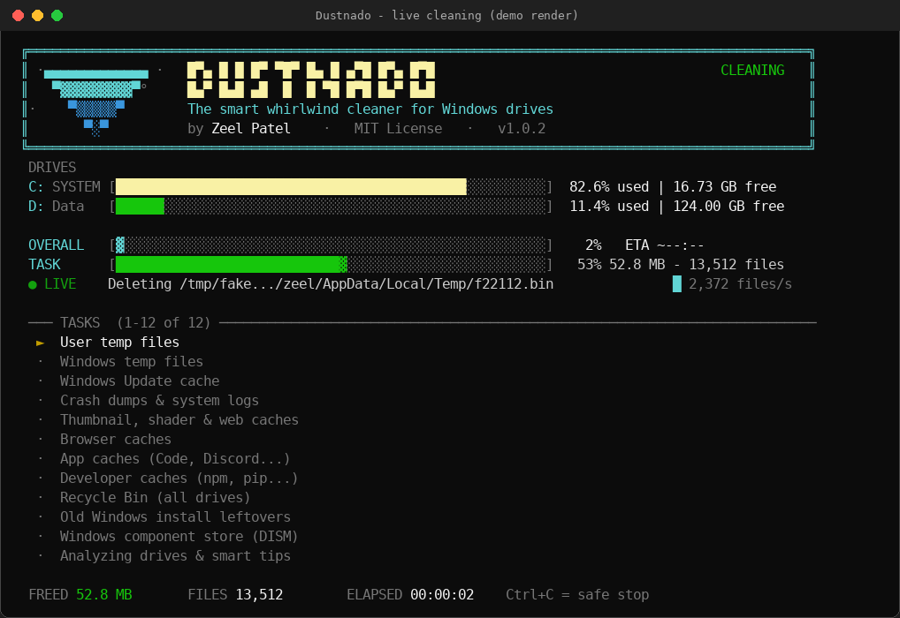
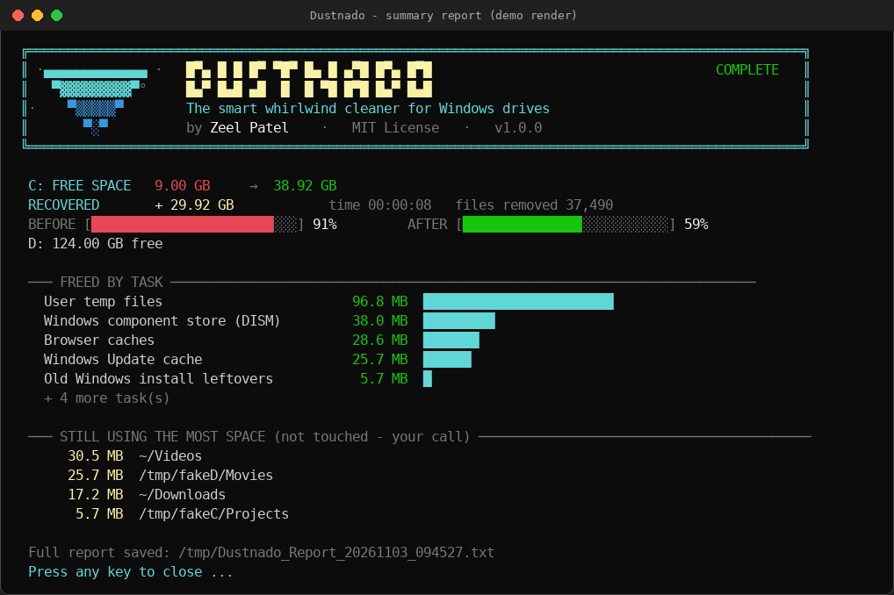

<div align="center">

# 🌪️ Dustnado
### The Ultra-Fast, Zero-Install Whirlwind Cleaner for Windows Drives

**Reclaim gigabytes of wasted disk space in seconds with real-time feedback and complete safety.**

<br/>

[](https://raw.githubusercontent.com/mr-zeel-38/dustnado/main/Dustnado.bat)
[](https://github.com/mr-zeel-38/dustnado)
[](https://github.com/mr-zeel-38/dustnado/releases/latest)

<br/>

[](LICENSE)
[](https://github.com/mr-zeel-38/dustnado/actions/workflows/ci.yml)
[](https://www.microsoft.com/windows)
[](https://microsoft.com/powershell)
[](#-how-it-works)
[](https://github.com/mr-zeel-38/dustnado/releases)
[](CONTRIBUTING.md)

<br/>

<a href="https://raw.githubusercontent.com/mr-zeel-38/dustnado/main/Dustnado.bat">
  
</a>

<p align="center">
  <sub>✨ <i>Real-time live progress with animated status, per-task metrics, speed graphs, and time estimates.</i></sub>
</p>

<p align="center">
  <a href="#-why-dustnado">Why Dustnado</a> •
  <a href="#-quick-start">Quick Start</a> •
  <a href="#-features">Features</a> •
  <a href="#-what-it-cleans">Cleaning Scope</a> •
  <a href="#-cli-options">CLI Options</a> •
  <a href="#-faq">FAQ</a> •
  <a href="#-star-history">Star History</a>
</p>

</div>

---

## ⚡ Why Dustnado?

Over time, Windows silently hoards **tens of gigabytes** of temporary files, obsolete update caches, browser leftovers, developer packages, and memory crash dumps. 

Traditional cleaning software often comes bundled with **background services, telemetry, annoying popups, and paid paywalls**. 

**Dustnado takes a completely different approach:**

* 📦 **Single Standalone File:** Just one lightweight `.bat` file — no installer, no extra runtime.
* 👁️ **100% Transparent & Readable:** Inspect the entire script before running. Zero telemetry or hidden code.
* 🛡️ **Non-Destructive & Safe:** Never touches your documents, passwords, or personal downloads.
* 🚀 **Multi-Drive & Multi-User:** Cleans every connected drive and all user profiles in one sweep.

| Feature | 🌪️ Dustnado | Typical Commercial Cleaners |
| :--- | :---: | :---: |
| **Installation Required** | ❌ **None** (Run directly) | ⚠️ Requires full installer |
| **Background Processes / Ads** | ❌ **Zero** | ⚠️ Frequent popups & upsells |
| **Open Source & Transparent** | ✅ **100% MIT** | ❌ Closed source / Black box |
| **All Drives & Profiles** | ✅ **Automatic** | ❌ Often limited to current user |
| **Safe Scan-Only Mode** | ✅ **Built-in (`/scan`)** | ⚠️ Often behind paywall |
| **Live UI & Speed Graph** | ✅ **Interactive Terminal** | ❌ Static progress bar |
| **Cost** | 🆓 **100% Free** | 💰 Subscription / Freemium |

---

## 🚀 Quick Start

### Method 1: GUI (Double-Click)
1. **[⬇️ Download `Dustnado.bat`](https://raw.githubusercontent.com/mr-zeel-38/dustnado/main/Dustnado.bat)** (or download from [Releases](https://github.com/mr-zeel-38/dustnado/releases/latest)).
2. **Double-click** the file and choose **Yes** on the Windows UAC Admin prompt.
3. Choose your action:
   - Press <kbd>ENTER</kbd> ➔ **Start Cleaning**
   - Press <kbd>S</kbd> ➔ **Safe Scan-Only Mode** (measures space, deletes nothing)
   - Press <kbd>Q</kbd> ➔ **Quit**

> 🛡️ **Fail-Safe Countdown:** If you don't press any key for 12 seconds, Dustnado automatically switches to a **Scan-Only** mode to prevent accidental deletions.

---

### Method 2: Command Line (CMD / PowerShell / Terminal)

Open Command Prompt or PowerShell as Administrator and run:

```bat
:: Measure potential space without deleting anything
Dustnado.bat /scan

:: Clean immediately without prompts
Dustnado.bat /yes

:: Clean but keep web browsers open
Dustnado.bat /yes /keepbrowsers
```

---

## 🌟 Key Features

<table>
  <tr>
    <td width="50%">
      <h3>🌪️ Real-Time Interactive UI</h3>
      Live animated spinners, active file counters, files-per-second throughput graph, and watchdog indicators that keep you informed on large directory passes.
    </td>
    <td width="50%">
      <h3>💽 Multi-Drive Intelligence</h3>
      Auto-detects every fixed local drive (C:, D:, E:...), analyzes free/used storage bars, sweeps temp stores, and clears Recycle Bins across all partitions.
    </td>
  </tr>
  <tr>
    <td width="50%">
      <h3>👥 Multi-User Sweeper</h3>
      Cleans caches and temporary stores across <b>all user accounts</b> on the computer, not just the currently logged-in account.
    </td>
    <td width="50%">
      <h3>🧠 Smart App & Dev Detection</h3>
      Automatically scans for installed developer ecosystems (Docker, Android Studio, Gradle, npm, pip, NuGet) and apps (VS Code, Discord, CapCut, Slack) to clear build caches safely.
    </td>
  </tr>
  <tr>
    <td width="50%">
      <h3>🛡️ Protected Path Guard</h3>
      Built-in safeguards check paths against protected system locations, verify active update locks, skip locked files gracefully, and preserve registry configurations.
    </td>
    <td width="50%">
      <h3>📄 Detailed Summary Report</h3>
      Generates an instant visual summary in the console and automatically exports a detailed audit report directly to your <code>Desktop</code>.
    </td>
  </tr>
</table>

<br/>

<div align="center">
  
  <p><sub>📊 <i>Comprehensive end-of-run storage breakdown and helpful relocation recommendations.</i></sub></p>
</div>

---

## 🧹 What It Cleans

Dustnado categorizes system detritus into precise, isolated modules:

| Target Category | Targets Cleaned |
| :--- | :--- |
| **System & User Temp** | `%TEMP%`, `C:\Windows\Temp`, crash dumps, minidumps, WER reports |
| **Windows Update** | SoftwareDistribution download cache, Delivery Optimization leftovers |
| **Graphics & Cache** | DirectX/D3D shader caches, NVIDIA/AMD caches, Explorer icon & thumbnail caches |
| **Web Browsers** | Chrome, Edge, Brave, and Firefox cache, code cache, GPU cache, and service workers |
| **Developer Tools** | `npm` cache, `pip` cache, `NuGet` cache, `Yarn`, Android Studio logs, Gradle daemon logs |
| **Popular Applications** | VS Code / Cursor caches, Discord cache, Slack cache, CapCut proxy/temp caches |
| **Storage Bins** | Empties the Recycle Bin on all fixed drives |
| **Legacy Windows** | `Windows.old`, `$WINDOWS.~BT`, and `$WINDOWS.~WS` upgrade residues |
| **Component Store** | Optional WinSxS cleanup via native Windows DISM engine (`/deep` support) |

### 🔒 What Dustnado NEVER Touches
* ❌ **Personal User Files:** Your `Documents`, `Downloads`, `Desktop`, `Pictures`, `Videos`, and `Music` are strictly untouched.
* ❌ **Saved Browser Data:** Bookmarks, saved passwords, browsing history, and cookies are never modified.
* ❌ **Installed Applications & Keys:** Software installations, activation keys, and critical registry hives remain intact.
* ❌ **Symbolic Links & Junctions:** Dustnado strictly avoids following junction targets outside designated folders.

---

## ⚙️ CLI Options

Customize Dustnado's behavior using convenient flags:

| Flag | Description | Default |
| :--- | :--- | :---: |
| `/scan` | **Safe Preview:** Calculates space savings without deleting a single file. | Off |
| `/yes` | **Headless / Unattended:** Starts cleaning immediately, bypassing the welcome countdown. | Off |
| `/keepbrowsers` | **Preserve Browsers:** Leaves open browser sessions running (skips locked browser caches). | Off |
| `/nodism` | **Skip DISM:** Bypasses Windows Component Store (WinSxS) compression for faster runs. | Off |
| `/deep` | **Deep Component Clean:** Invokes DISM `/ResetBase` (removes old update rollback versions). | Off |
| `/help` | Displays command syntax, supported switches, and usage guidelines. | Off |

#### Practical Examples:
```bat
:: Perform a safe preliminary audit
Dustnado.bat /scan

:: Quick daily sweep while keeping work browsers open
Dustnado.bat /yes /keepbrowsers /nodism

:: Thorough monthly maintenance sweep with deep DISM reset
Dustnado.bat /deep
```

---

## 🔧 How It Works

Dustnado uses a hybrid architecture combining the universality of batch files with the raw power of PowerShell and .NET:

```text
Dustnado.bat
 │
 ├── 1. Batch Bootstrap
 │    └── Validates UAC elevation; prompts for Admin permission if needed
 │
 └── 2. Embedded PowerShell & .NET Engine
      ├── Threaded Worker  ──> High-speed asynchronous file scanning & deletion
      ├── Auto-Discovery   ──> Enumerates mounted drives, user profiles, installed apps
      ├── Cleaning Pipeline──> 13 safety-isolated cleanup phases with progress monitoring
      └── Reporting Engine ──> Renders terminal dashboard and writes Desktop summary report
```

---

## 📋 System Requirements

* **Operating System:** Windows 10 or Windows 11 (64-bit / 32-bit)
* **PowerShell:** Version 5.1 or newer *(pre-installed on all modern Windows versions)*
* **Privileges:** Administrator rights *(prompted automatically upon launch)*
* **Console:** Windows Terminal, PowerShell, or Command Prompt *(standard window width recommended)*

---

## ❓ Frequently Asked Questions

<details>
<summary><b>Is running Dustnado completely safe for my PC?</b></summary>
<br/>
Yes. Dustnado only targets transient cache files, temporary log entries, and discarded installation leftovers that Windows and apps automatically regenerate as needed. Every directory deletion passes through an internal strict-path whitelist, preventing accidental modification of system files.
</details>

<details>
<summary><b>Why does Dustnado need Administrator privileges?</b></summary>
<br/>
Cleaning system-wide caches like <code>C:\Windows\Temp</code>, Windows Update download stores, WinSxS component files, and secondary user profiles requires administrative access.
</details>

<details>
<summary><b>Will Dustnado log me out of my websites or close my work?</b></summary>
<br/>
Dustnado cleans caches (temporary images, scripts, style sheets) and <b>never touches your cookies, sessions, or saved passwords</b>. If you prefer to leave your browser windows running while cleaning, simply pass the <code>/keepbrowsers</code> flag.
</details>

<details>
<summary><b>Why does DISM cleanup take longer on the first run?</b></summary>
<br/>
The Windows Component Store (WinSxS) holds historical updates and compressed system packages. Windows DISM analyzes package dependencies during cleanup, which may take several minutes depending on your CPU and drive speed. You can pass <code>/nodism</code> if you want an ultra-fast sweep.
</details>

<details>
<summary><b>Does Dustnado install any persistent services or startup items?</b></summary>
<br/>
Never. When Dustnado finishes, it cleans up all its internal memory and exits completely. No background daemons, no registry run keys, and no telemetry pings.
</details>

---

## 🗺️ Project Roadmap

- [ ] ⏱️ Scheduled / Silent Mode for automated Task Scheduler runs (`/silent`)
- [ ] 📊 JSON / CSV structured report output for sysadmins
- [ ] 🎮 Extended game client caches (Steam shader caches, Epic Games, Battle.net)
- [ ] 📦 Official `winget` & `Scoop` manifests
- [ ] 🌐 Multi-language console localization

---

## 🤝 Contributing

Contributions make open-source amazing! Whether it's adding new safe cleanup targets, improving compatibility, or enhancing performance:

1. Fork the Project
2. Create your Feature Branch (`git checkout -b feature/NewCleanupTarget`)
3. Commit your Changes (`git commit -m "Add Discord Canary cache target"`)
4. Push to the Branch (`git push origin feature/NewCleanupTarget`)
5. Open a Pull Request

See [CONTRIBUTING.md](CONTRIBUTING.md) for full guidelines.

<div align="center">
  <a href="https://github.com/mr-zeel-38/dustnado/graphs/contributors">
    
  </a>
</div>

---

## 📈 Star History

If Dustnado helped free up space on your drives, please consider giving it a star! ⭐

<div align="center">

<a href="https://star-history.com/#mr-zeel-38/dustnado&Date">
  
</a>

<p>
  <a href="https://github.com/mr-zeel-38/dustnado">
    
  </a>
</p>

</div>

---

## 📄 License & Credits

Distributed under the **MIT License**. See [LICENSE](LICENSE) for more details.

Created with passion by **[Zeel Patel](https://github.com/mr-zeel-38)**.

<div align="center">

<sub>Made with 🌪️ for fast, clean, and healthy Windows drives.</sub>

</div>
