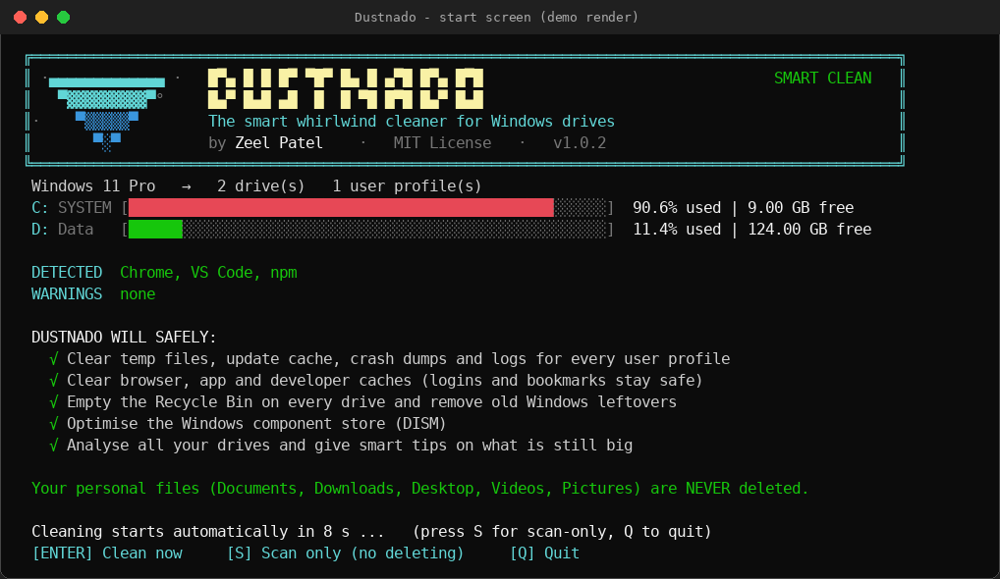

<div align="center">


<br/><br/>

# 🌪️ Dustnado

### Sweep your Windows drives clean — in one double-click.

**One file. No install. Live progress. 100% open source.**

<br/>

[](https://github.com/mr-zeel-38/dustnado/releases/latest/download/Dustnado.bat)
[](https://github.com/mr-zeel-38/dustnado)
[](https://github.com/mr-zeel-38/dustnado/releases/latest)

[](LICENSE)
[](https://github.com/mr-zeel-38/dustnado/actions/workflows/ci.yml)


[](CONTRIBUTING.md)

<sub>Screenshots in this README are demo renders with simulated data.</sub>

</div>

<br/>

**Jump to:** [Quick start](#-quick-start) · [What you'll see](#-what-youll-see) · [Features](#-features) · [What it cleans](#-what-it-cleans) · [Safety](#%EF%B8%8F-how-dustnado-stays-safe) · [Options](#%EF%B8%8F-options) · [FAQ](#-faq--troubleshooting) · [Contributing](#-contributing)

---

## 💡 What is Dustnado?

Windows quietly piles up **gigabytes of junk**: update leftovers, browser caches, crash dumps, developer caches, old Windows installs.
Dustnado removes it for you — automatically, safely, and with a live view of what it is doing.

| | |
|---|---|
| 📦 **One file** | A single `Dustnado.bat`. No installer, no runtime, nothing left behind. |
| 👀 **Readable** | The whole program is one script you can read in minutes. No telemetry, no ads, no network access. |
| 💽 **All drives, all users** | Detects every fixed drive and every user profile on the PC. |
| 🛡️ **Safe by design** | Only touches caches, temp files, logs and leftovers. Has a **scan-only mode** that deletes nothing. |

---

## 🚀 Quick start

<table>
<tr>
<td align="center" width="33%"><h3>① Download</h3><a href="https://github.com/mr-zeel-38/dustnado/releases/latest/download/Dustnado.bat"><b>Dustnado.bat</b></a><br/><sub>or from <a href="https://github.com/mr-zeel-38/dustnado/releases/latest">Releases</a></sub></td>
<td align="center" width="33%"><h3>② Double-click</h3>Click <b>Yes</b> on the Windows admin prompt.<br/><sub>Needed to clean system folders.</sub></td>
<td align="center" width="33%"><h3>③ Relax</h3>Cleaning starts by itself.<br/><sub>Watch the live progress, read the report.</sub></td>
</tr>
</table>

> ⬇️ **Download not starting?** Open the [Releases page](https://github.com/mr-zeel-38/dustnado/releases/latest) and click **Dustnado.bat** under *Assets* — or [download the whole project as a ZIP](https://github.com/mr-zeel-38/dustnado/archive/refs/heads/main.zip).

On the start screen you have **12 seconds** to choose — or do nothing and it cleans:

| Key | Action |
|:---:|---|
| <kbd>ENTER</kbd> | 🧹 **Clean now** (skip the countdown) |
| <kbd>S</kbd> | 🔍 **Scan only** — measure what could be freed, delete nothing |
| <kbd>Q</kbd> | 🚪 Quit |
| *(no key)* | 🧹 Cleaning starts automatically after the countdown |

> 💡 **First time and a bit nervous?** Press <kbd>S</kbd> (or run `Dustnado.bat /scan`). When the scan finishes, press <kbd>C</kbd> on the report to clean — no restart needed.

---

## 📸 What you'll see

<table>
<tr>
<td width="50%" align="center"><br/><b>1 · Start screen</b><br/><sub>Detects your drives, apps and warnings. Countdown, then cleans.</sub></td>
<td width="50%" align="center"><br/><b>2 · Live cleaning</b><br/><sub>Blinking progress, current file, speed graph, ETA.</sub></td>
</tr>
<tr>
<td colspan="2" align="center"><br/><b>3 · Summary report</b><br/><sub>Space recovered, what freed the most, and smart tips. A full <code>.txt</code> report is saved to your Desktop.</sub></td>
</tr>
</table>

---

## ✨ Features

| | | |
|---|---|---|
| 🌪️ **Live UI**<br/><sub>Blinking progress head, pulsing `LIVE` dot, current file path, files-per-second graph, ETA, and a "still working" watchdog.</sub> | 💽 **All drives**<br/><sub>Live usage bars for every fixed drive; Recycle Bin emptied on each.</sub> | 👥 **All users**<br/><sub>Cleans every user profile, not just the one that launched it.</sub> |
| 🧠 **Smart detection**<br/><sub>Cleans only what you actually have: Chrome, Edge, Brave, Firefox, VS Code, Discord, CapCut, npm, Android Studio…</sub> | 💡 **Smart tips**<br/><sub>Spots a huge hibernation file, folders worth moving to a roomier drive, Android/WSL/Docker disks.</sub> | 📄 **Report**<br/><sub>On-screen summary plus a full text report on your Desktop.</sub> |
| ⚡ **Fast**<br/><sub>A native background worker handles 100,000+ files without freezing.</sub> | 🔍 **Scan-only mode**<br/><sub>Preview everything first. Press <kbd>C</kbd> afterwards to clean.</sub> | 🛡️ **Guarded**<br/><sub>Protected-path guard, locked files skipped, junctions never followed.</sub> |

---

## 🧹 What it cleans

Cleaning runs in **12 steps** (cleaning first, analysis last):

| # | Step | What is removed |
|:-:|---|---|
| 1 | **User temp files** | `%TEMP%` of every user |
| 2 | **Windows temp files** | `C:\Windows\Temp` |
| 3 | **Windows Update cache** | Download cache, Delivery Optimization cache |
| 4 | **Crash dumps & logs** | Crash dumps, minidumps, error reports, CBS / DISM / Update logs |
| 5 | **Thumbnail, shader & web caches** | Explorer thumbnails & icon cache, NVIDIA / AMD / D3D shader caches, INetCache |
| 6 | **Browser caches** | Cache, Code Cache, GPU & Service Worker caches — Chrome, Edge, Brave, Firefox |
| 7 | **App caches** | VS Code, Cursor, Discord, Slack, CapCut, Store-app temp state |
| 8 | **Developer caches** | npm, Yarn, pip, NuGet, Android Studio caches & logs, Gradle daemon logs |
| 9 | **Recycle Bin** | On every fixed drive |
| 10 | **Old Windows leftovers** | `Windows.old`, `$WINDOWS.~BT`, `$WINDOWS.~WS` |
| 11 | **Component store (DISM)** | WinSxS cleanup (deeper with `/deep`) |
| 12 | **Analysis & smart tips** | Scans all drives and reports what is still big — **never deletes** |

<details>
<summary><b>🔒 What Dustnado NEVER touches</b> (click to expand)</summary>

<br/>

- ❌ Your **Documents, Downloads, Desktop, Pictures, Videos, Music**
- ❌ Browser **passwords, bookmarks, history, cookies and logins**
- ❌ Installed programs, activation keys and the registry
- ❌ Anything outside the locations in the table above
- ❌ Junctions / symbolic links are never followed outside the cleanup folders

Big folders found in step 12 are only **reported** as tips. You decide what to do with them.

</details>

---

## 🛡️ How Dustnado stays safe

- **Scan-only mode** (`S` / `/scan`) shows exactly what would be freed before anything is deleted.
- **Protected-path guard:** refuses to delete drive roots, `Windows`, `Users`, `Program Files` and other top-level system folders.
- **Locked or in-use files are skipped**, never forced.
- **Smart skips:** the Windows Update steps are skipped while updates are installing; DISM is skipped when a restart is pending.
- **Services are restored:** any Windows service it pauses is started again — even if you press `Ctrl+C`.
- **Offline & transparent:** the script never connects to the internet and contains no telemetry.

---

## ⚙️ Options

Run from a terminal (or add them to a shortcut):

| Option | What it does |
|---|---|
| `/scan` | **Scan only** — show what could be freed, delete nothing |
| `/yes` | Start immediately, skip the countdown screen |
| `/keepbrowsers` | Don't close open browsers (their caches are partly skipped) |
| `/nodism` | Skip the component-store cleanup (faster) |
| `/deep` | Deeper DISM cleanup (`/ResetBase`) — installed Windows updates can no longer be uninstalled |
| `/help` | Show help |

```bat
Dustnado.bat /scan                      :: preview only
Dustnado.bat /yes                       :: clean right now, no questions
Dustnado.bat /yes /keepbrowsers /nodism :: quick sweep, keep browsers open
Dustnado.bat /deep                      :: thorough monthly clean
```

Prefer editing? All feature switches are in the **SETTINGS** block at the top of the PowerShell section inside `Dustnado.bat`.

---

## 🔧 How it works

```text
Dustnado.bat
 ├─ Batch header      → checks Administrator rights, relaunches itself elevated (UAC)
 └─ PowerShell engine (embedded in the same file)
     ├─ Native .NET worker thread → fast scan / delete + live counters for the UI
     ├─ Discovery                 → drives, user profiles, installed apps
     ├─ 12 cleanup steps          → each one measurable (/scan) and guarded
     └─ UI + report               → live bars, summary, Desktop report, smart tips
```

---

## ❓ FAQ & troubleshooting

<details>
<summary><b>It only scanned and nothing was deleted</b></summary>
<br/>
That happens when you pressed <kbd>S</kbd>, used <code>/scan</code>, or ran an older version (v1.0.1) whose countdown ended in scan-only. In v1.0.2+ the countdown <b>cleans</b>. After any scan, press <kbd>C</kbd> on the report to clean right away.
</details>

<details>
<summary><b>Windows says "Windows protected your PC" (SmartScreen)</b></summary>
<br/>
The file is an unsigned script downloaded from the internet. Click <b>More info → Run anyway</b> — or read the source first, it is a single file.
</details>

<details>
<summary><b>My antivirus flagged it</b></summary>
<br/>
Scripts that delete files and compile a small helper (<code>Add-Type</code>) can trigger heuristic warnings. Read the code, then allow it — or skip it if you are not comfortable.
</details>

<details>
<summary><b>How can I verify my download?</b></summary>
<br/>
Every <a href="https://github.com/mr-zeel-38/dustnado/releases/latest">release</a> also contains <code>Dustnado.bat.sha256</code>. Compare it with your file: <code>certutil -hashfile Dustnado.bat SHA256</code>.
</details>

<details>
<summary><b>Will it log me out of websites?</b></summary>
<br/>
No. Cookies, logins and saved passwords are never touched. Dustnado closes your browsers so their caches can be cleaned (use <code>/keepbrowsers</code> to avoid that).
</details>

<details>
<summary><b>Why does it need Administrator rights?</b></summary>
<br/>
Cleaning <code>C:\Windows\Temp</code>, the Windows Update cache, DISM and other users' profiles requires it.
</details>

<details>
<summary><b>Why was the DISM step slow or skipped?</b></summary>
<br/>
Component-store cleanup can take several minutes. It is skipped automatically when updates are installing or a restart is pending — restart Windows and run again. Use <code>/nodism</code> to skip it on purpose.
</details>

<details>
<summary><b>The layout looks cut off</b></summary>
<br/>
Maximize the window, or make it at least 90 columns wide.
</details>

---

## 📋 Requirements

- **Windows 10 or 11** with Windows PowerShell **5.1** (already included)
- **Administrator** rights (it asks automatically)
- A terminal window of about **90 × 28** or larger

## 🗂️ Project structure

```text
dustnado/
├─ Dustnado.bat        ← the whole program
├─ README.md
├─ CHANGELOG.md
├─ CONTRIBUTING.md
├─ SECURITY.md
├─ LICENSE             ← MIT
├─ docs/               ← screenshots
└─ .github/            ← CI check + issue templates
```

## 🗺️ Roadmap

- [ ] ⏱️ Silent / scheduled mode (`/silent`, Task Scheduler helper)
- [ ] 📊 JSON report output for scripting
- [ ] 🎮 More app caches (Teams, Zoom, Steam, Epic, Adobe)
- [ ] 📦 `winget` and Scoop packages
- [ ] 🌐 Localized interface

Have an idea? [Open an issue](https://github.com/mr-zeel-38/dustnado/issues/new/choose).

## 🤝 Contributing

PRs are welcome — especially **new safe cleanup targets**. Please read [CONTRIBUTING.md](CONTRIBUTING.md) first (the key rule: only clean things that Windows or the app re-creates automatically).

```bash
git checkout -b feature/new-cleanup-target
git commit -m "Add <app> cache target"
git push origin feature/new-cleanup-target
```

## ⭐ Star history

If Dustnado freed up space on your PC, a ⭐ helps other people find it!

<div align="center">

<a href="https://star-history.com/#mr-zeel-38/dustnado&Date">
  
</a>

</div>

## ⚠️ Disclaimer

Dustnado is provided **as is**, without warranty (see the license). Keep backups of important data, and run **scan-only** first if you are unsure.

## 📄 License & credits

Released under the [MIT License](LICENSE).

Created with ❤️ by **[Zeel Patel](https://github.com/mr-zeel-38)**.

<div align="center"><sub>Made with 🌪️ for fast, clean Windows drives.</sub></div>
